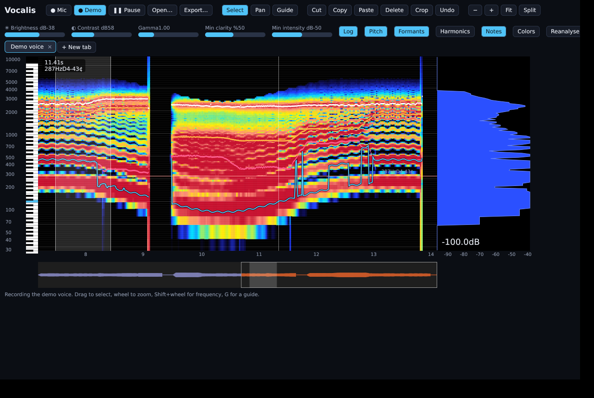

# Vocalis

A voice analysis studio written in Silk with Loom and drawn with WebGPU in a native window.



- **Spectrogram**: scrolling, 0–5 kHz, 2048-point FFT, 512-sample hop, with an inferno-style colour ramp
- **Pitch**: YIN pitch detection drawn as a green track over the spectrogram, with Hz, note name and cents
- **Formants**: F1, F2 and F3 from LPC (order 14), drawn as coloured dots and shown as readouts
- **Spectrum slice**: the current spectrum next to the spectrogram, with the formants marked
- **Level**: RMS in dBFS with a meter

Interaction:

- **Tabs and split view:** several recordings open at once (`+ New tab`, `Open…`), and `Split` shows two of them stacked.
- **Zoom and pan:** the wheel zooms time at the pointer, Shift+wheel zooms frequency, and Alt+wheel or a horizontal scroll pans. Drag with the Pan tool (or a non-left button, or Alt) to pan. Drag on the overview to move the view. `−` `+` `Fit`, `=` `-` `0`, and the arrow keys do the same.
- **Display:** Brightness (top dB) and Contrast (dynamic range dB) as in the colormap settings of voice tools, plus Gamma, Log/linear scale, note lines, three colormaps, and pitch, formant and harmonic overlays.
- **Pitch detection:** Min clarity and Min intensity; `Reanalyse` applies them to existing audio.
- **Guides:** `G` or the Guide tool places a frequency guide labelled with Hz and note name. Drag a guide to move it, double-click it to remove it, or use `Clear guides`.
- **Editing:** drag to select, then Cut ⌘X, Copy ⌘C, Paste ⌘V, Delete, Crop ⌘K, Undo ⌘Z and Select all ⌘A. `Export…` writes a 16-bit WAV.

Sources: **Demo voice** (a built-in synthetic singer gliding through a-e-i-o-u with vibrato),
**Open WAV…** (16-bit PCM or 32-bit float, any channel count or rate) and **Microphone**.

| File | What it holds |
| --- | --- |
| `src/studio.silk` | the Loom program: tabs, panes, interaction, editing, view |
| `src/render.silk` | spectrogram, piano, slice, overview drawings and axis ticks |
| `src/track.silk` | a recording and its analysis; segment/splice for editing |
| `src/dsp.silk` | FFT, Hann window, dB spectrum, RMS, YIN pitch, LPC formants |
| `src/source.silk` | the `Sound` service the program asks for samples |
| `src/main.silk` | the native window, the machine's `Sound` (WAV decoding, microphone) |

```sh
cd apps/vocalis && silk build && ./build/llvm/x86_64-unknown-linux-gnu/debug/vocalis
```

## Status

It compiles, and runs on Linux (X11, with lavapipe drawing WebGPU on the CPU, as in the screenshot). Known gaps:

- The microphone is stubbed (`startMic` returns false, and the app falls back to the demo
  voice). Silk's standard library has no child-process pipe or audio capture API that the code
  could find yet. The plan is to stream `parec`, `arecord` or `sox` output, or to add a native
  CoreAudio/PulseAudio binding.
- `dsp.silk` defines its own `ln`/`log10`, because no `f32.log` was found.
- History buffers shift on every column. A ring buffer would be cheaper.

It needs the X11, xkbcommon, Wayland and wayland-protocols development packages and LLVM 22 (`SILK_CLANG`), like the other native apps here.
